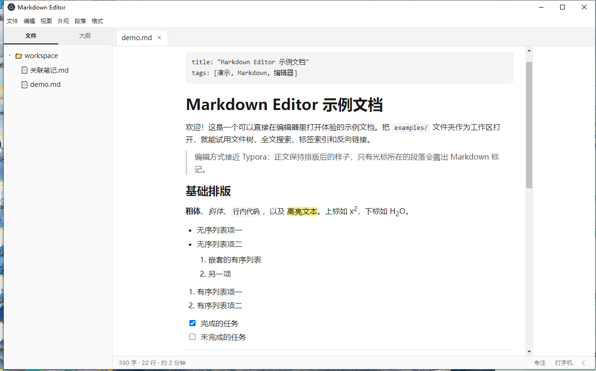
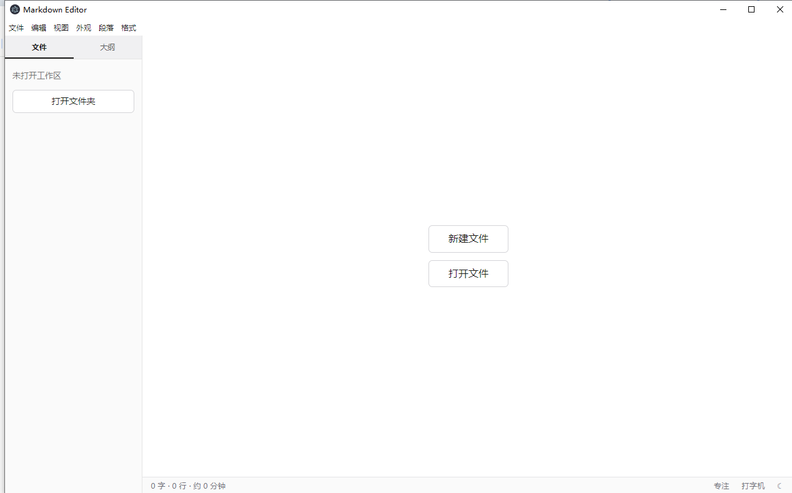

# Markdown Editor

**English** | [中文](README.zh-CN.md)

A desktop Markdown editor built with Electron, React, and TipTap. It uses Typora-like hybrid editing: the document stays formatted, and Markdown markers appear only on the block you are editing.

## Screenshots



*Editing view with file tree and centered reading column*



*Welcome screen when no file is open*

## Features

- **Hybrid editing** — markers show on the focused block, and formatting applies as you type
- **Rich Markdown** — GFM tables, images, task lists, and fenced code blocks with syntax highlighting
- **Workspace index** — full-text search, a Front Matter tag index, and wiki backlinks across every `.md` file in the workspace
- **Wiki links** — `[[Target|Alias]]` atoms resolve by filename or path; click to open, with a backlinks panel for incoming and outgoing references
- **Documents and navigation** — file tree, tabs, outline with stable anchors, clickable TOC and footnote jumps, plus recent files and folders
- **Paragraph and Format menus** — math blocks, YAML front matter, footnotes, table of contents, HTML blocks, superscript/subscript, and highlight (`==x==`); edits round-trip back to source Markdown
- **Export** — self-contained HTML and PDF with syntax-highlighted code blocks and heading IDs that match the generated TOC
- **Resizable sidebar** — five panels (files, outline, tags, search, backlinks); drag to resize, and window/sidebar sizes are remembered
- **Centered reading column** — on wide windows the text stays in a centered column

> Math and raw HTML blocks are kept as source and shown monospaced; they are not typeset or rendered live in the editor.

## Develop

```bash
npm install
npm run dev
npm test
```

`npm run dev` starts the Electron app. `npm test` runs the Vitest suite once.

## Download

Prebuilt binaries are on the [Releases](https://github.com/toby127/markdown-editor/releases) page (currently [v0.1.1](https://github.com/toby127/markdown-editor/releases/tag/v0.1.1)):

- **Windows** — installer (`Markdown.Editor.Setup.*.exe`), portable executable (`Markdown.Editor.*.exe`), and portable zip (`Markdown.Editor.zip`)
- **macOS** — DMG and ZIP for Intel (`x64`) and Apple Silicon (`arm64`), built on GitHub Actions

macOS builds are unsigned. On first launch, if macOS blocks the app, right-click it → **Open**, then confirm. After that, a normal double-click works.

## Windows build

```bash
npm run dist
```

The command builds the app, then packages a Windows x64 installer and a portable executable. Artifacts land under `release/`.

If `app.asar` is locked by a file indexer, pass an output directory outside the workspace, for example:

```bash
npx electron-builder --win -c.directories.output="C:/Users/<you>/Downloads/markdown-editor-dist"
```

## macOS build

```bash
npm run dist:mac
```

Requires macOS (or CI on `macos-latest`). Produces unsigned DMG and ZIP artifacts under `release/`. The GitHub Actions workflow `.github/workflows/release-mac.yml` builds these and attaches them to the release (version tags `v*` on push; default tag `v0.1.1` on manual dispatch).

## License

[MIT](LICENSE)
