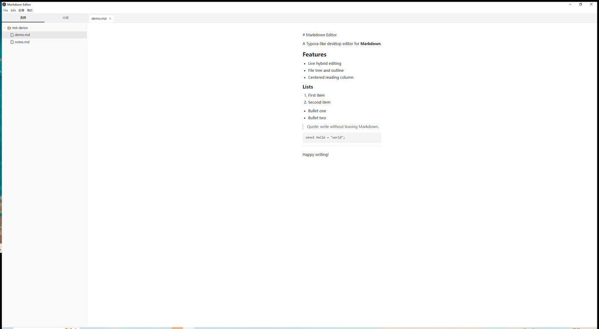
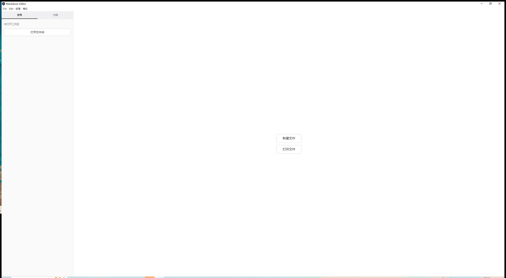

# Markdown Editor

[English](README.md) | **中文**

基于 Electron、React 和 TipTap 的桌面 Markdown 编辑器。编辑方式接近 Typora：正文以排好版的样子呈现，只有正在编辑的段落会露出 Markdown 标记。

## 截图



*带文件树和居中阅读栏的编辑视图*



*未打开文件时的欢迎界面*

## 功能

- **混合编辑** — 焦点所在的块显示标记，格式随输入即时生效
- **文件与导航** — 文件树、标签页、大纲，以及最近打开的文件和文件夹
- **段落与格式菜单** — 菜单布局对齐 Typora
- **可调侧边栏** — 可拖动调整宽度；窗口大小和侧边栏宽度会被记住
- **居中阅读栏** — 窗口较宽时，正文保持在中间一栏

## 开发

```bash
npm install
npm run dev
npm test
```

`npm run dev` 会启动 Electron 开发窗口。`npm test` 用 Vitest 跑一遍测试。

## 下载

预编译包在 [Releases](https://github.com/toby127/markdown-editor/releases) 页面（当前为 [v0.1.0](https://github.com/toby127/markdown-editor/releases/tag/v0.1.0)）：

- **Windows** — 安装包（`Markdown.Editor.Setup.*.exe`）与便携版（`.exe`）
- **macOS** — Intel（`x64`）与 Apple Silicon（`arm64`）的 DMG 和 ZIP

macOS 构建未签名。首次打开若被系统拦截，请对应用右键 → **打开**，再确认；之后即可双击启动。

## Windows 构建

```bash
npm run dist
```

这条命令会先完成构建，再打出 Windows x64 安装包和便携版。产物都在 `release/` 目录下。

## macOS 构建

```bash
npm run dist:mac
```

需要在 macOS 上执行（或使用 `macos-latest` 的 CI）。会生成未签名的 DMG 与 ZIP，产物在 `release/`。GitHub Actions 工作流 `.github/workflows/release-mac.yml` 负责构建并上传到 Release（手动触发默认挂到 `v0.1.0`；推送 `v*` 标签时挂到对应标签）。

## 许可证

[MIT](LICENSE)
