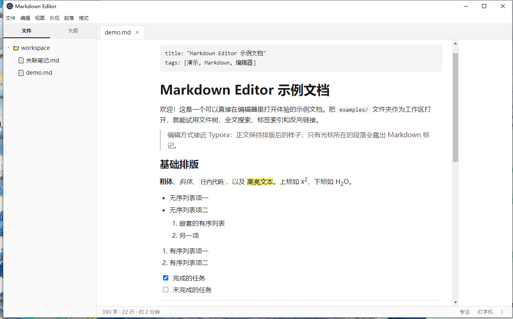
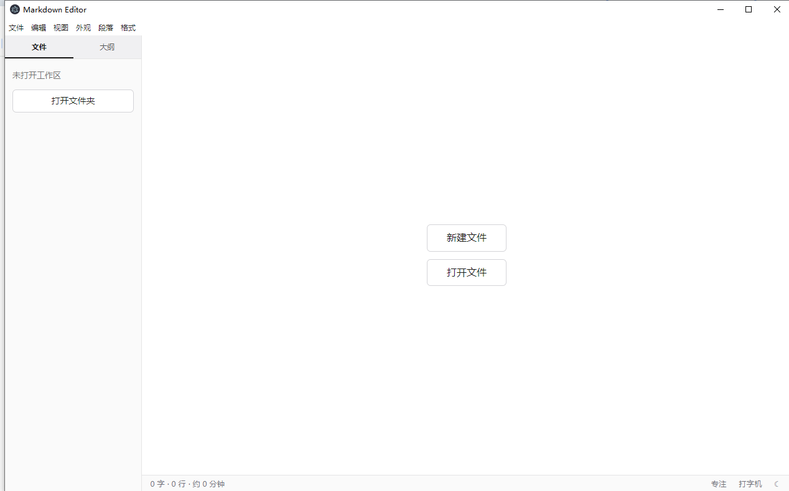

# Markdown Editor

[English](README.md) | **中文**

基于 Electron、React 和 TipTap 的桌面 Markdown 编辑器。编辑方式接近 Typora：正文以排好版的样子呈现，只有正在编辑的段落会露出 Markdown 标记。

## 截图



*带文件树和居中阅读栏的编辑视图*



*未打开文件时的欢迎界面*

## 功能

- **混合编辑** — 焦点所在的块显示标记，格式随输入即时生效
- **丰富的 Markdown** — GFM 表格、图片、任务列表，以及带语法高亮的围栏代码块
- **工作区索引** — 全文搜索、Front Matter 标签索引，以及覆盖工作区所有 `.md` 文件的 Wiki 反链
- **双向链接** — `[[目标|别名]]` 按文件名或路径解析，点击即可打开；反链面板显示出链与反向引用
- **文档内查找与替换** — Ctrl+F 浮层，实时高亮匹配、上一个/下一个定位、区分大小写与全词匹配，支持替换与全部替换
- **文档与导航** — 文件树、标签页、带稳定锚点的大纲，可点击的目录与脚注跳转，以及最近打开的文件和文件夹
- **段落与格式菜单** — 公式块、YAML Front Matter、脚注、内容目录、HTML 块、上下标、高亮（`==x==`）；编辑后可无损往返为源 Markdown
- **导出** — 自包含的 HTML 与 PDF，代码块带语法高亮，标题 ID 与生成的目录一致
- **可调侧边栏** — 五个面板（文件/大纲/标签/搜索/反链）；可拖动调整宽度，窗口与侧边栏宽度会被记住
- **居中阅读栏** — 窗口较宽时，正文保持在中间一栏

> 公式与原始 HTML 块以源码形式保留并等宽显示，编辑器内不做排版或实时渲染。

## 开发

```bash
npm install
npm run dev
npm test
```

`npm run dev` 会启动 Electron 开发窗口。`npm test` 用 Vitest 跑一遍测试。

## 下载

预编译包在 [Releases](https://github.com/toby127/markdown-editor/releases) 页面（当前为 [v0.1.2](https://github.com/toby127/markdown-editor/releases/tag/v0.1.2)）：

- **Windows** — 安装包（`Markdown.Editor.Setup.*.exe`）、便携版（`.exe`）与便携 zip（`Markdown.Editor.zip`）
- **macOS** — 由 GitHub Actions 构建的 Intel（`x64`）与 Apple Silicon（`arm64`）DMG 和 ZIP

macOS 构建未签名。首次打开若被系统拦截，请对应用右键 → **打开**，再确认；之后即可双击启动。

## Windows 构建

```bash
npm run dist
```

这条命令会先完成构建，再打出 Windows x64 安装包和便携版。产物都在 `release/` 目录下。

如果 `app.asar` 被文件索引器占用，可以把输出目录指定到工作区外，例如：

```bash
npx electron-builder --win -c.directories.output="C:/Users/<you>/Downloads/markdown-editor-dist"
```

## macOS 构建

```bash
npm run dist:mac
```

需要在 macOS 上执行（或使用 `macos-latest` 的 CI）。会生成未签名的 DMG 与 ZIP，产物在 `release/`。GitHub Actions 工作流 `.github/workflows/release-mac.yml` 负责构建并上传到 Release（推送 `v*` 标签时挂到对应标签；手动触发默认挂到 `v0.1.2`）。

## 许可证

[MIT](LICENSE)
